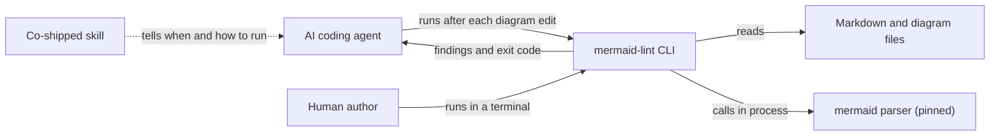
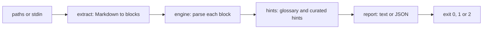
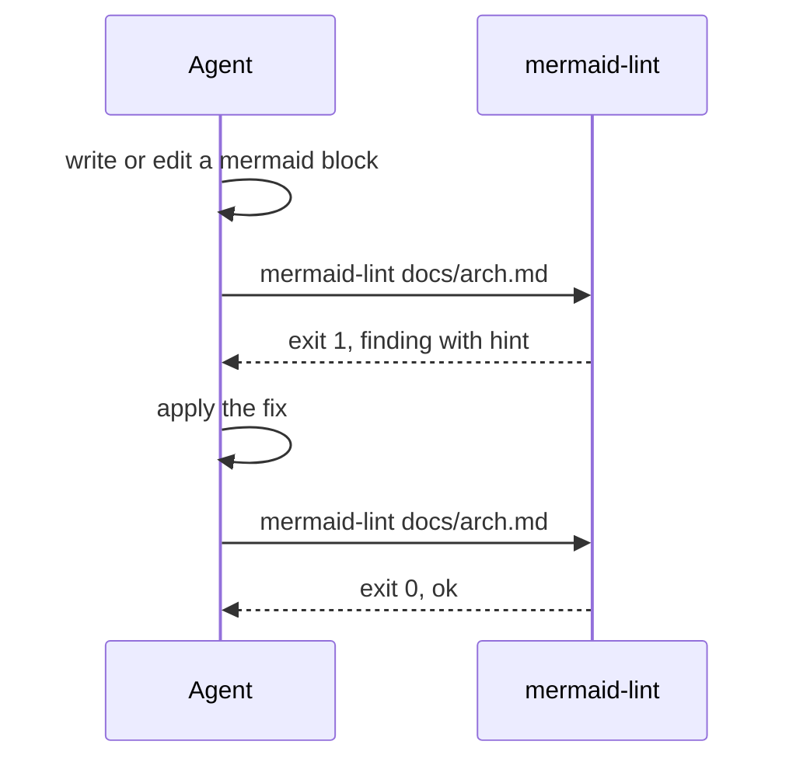

# mermaid-lint — Design (v0.1.0)

> Date: 2026-11-20 · Mode: Design · Interface: CLI plus one agent skill
> State: [Progress overview](../progress/overview-v0.1.md)

`mermaid-lint` checks the Mermaid diagrams inside Markdown files. It runs the real
Mermaid parser, reports each failure at its line in the Markdown file, and adds a hint
that says how to fix it. Its first user is an AI coding agent that checks the diagram
it just wrote.

## 1. Requirements

### Problem

An agent writes a Mermaid block in a Markdown document and cannot see the rendered
result. A syntax error shows only later, as a broken diagram in a viewer. The agent
needs a fast, local, text-only check that it can run after each edit.

Existing tools do not fit (see [Evidence](#2-evidence)):

- The official `mermaid-cli` validates only as a side effect of rendering and needs a
  headless browser.
- Linters with their own grammars cover a subset of diagram types and can disagree
  with the real renderer.

### Users

| User                      | Need                                                                             |
| ------------------------- | -------------------------------------------------------------------------------- |
| AI coding agent (primary) | Verdict, location, and a next move, in few tokens, with exit codes to branch on. |
| Human author              | The same check from a terminal.                                                  |
| CI job (later)            | A non-zero exit when a document has a broken diagram.                            |

### Goals and non-goals

Goals:

- Same verdict as the pinned Mermaid parser, for every diagram type it supports.
- Locations in the coordinates of the file the user edits, not of the diagram block.
- Errors that teach: plain words and a concrete fix.
- A small, stable contract: one command, two flags, three exit codes.

Non-goals for v0.1.0:

- No autofix. The caller edits; the tool only judges.
- No rendering, no layout or style rules, no configuration file.
- No MCP server. The CLI and the skill are the only agent interface.
- No npm publication. Installation is from a checkout.

### Capabilities

| ID   | Priority | Capability                                                                      |
| ---- | -------- | ------------------------------------------------------------------------------- |
| R-01 | P0       | Find every Mermaid fenced block in a Markdown file; accept a bare diagram file. |
| R-02 | P0       | Give the pinned Mermaid parser's verdict for each block.                        |
| R-03 | P0       | Report `file:line:column` in the Markdown file, with the source line.           |
| R-04 | P0 | Exit `0` (clean), `1` (findings), `2` (the check could not run: usage, I/O or internal error). |
| R-05 | P0       | Translate raw parser tokens to real characters; add a hint for common causes.   |
| R-06 | P0       | `--json` output with a versioned schema.                                        |
| R-07 | P0       | Ship a minimal agent skill inside the install unit.                             |
| R-08 | P1       | Accept directories (recursive) and standard input.                              |
| R-09 | P2       | Respect `.gitignore` in directory scans; publish to npm; CI release drafts.     |

### Constraints

- No browser and no network at run time.
- Deterministic: the same input and the same pinned Mermaid version give the same
  output.
- Node.js 22.12 or later (the floor of the pinned `mermaid` package).

### Success criteria

1. Corpus: every valid fixture gives zero findings and every invalid fixture gives at
   least one, except the mismatches listed in `tests/fixtures/maid/known-mismatches.json`.
2. Line mapping: for each case in the line-map tests (frontmatter, directive, comment,
   indented fence, CRLF), the reported line is the true line in the file.
3. One Markdown file with three diagrams completes in under 1 second on a developer
   laptop.
4. The skill is 25 lines or fewer and names no Mermaid syntax rule.

## 2. Evidence

These checks were made on 2026-11-20 with Node.js 26.13, `mermaid` 12.3.0 and
`happy-dom` 21.0.4. They are observations at those versions, not guarantees.

- **The parser runs without a browser.** `mermaid.parse()` gave the correct verdict on
  15 of 15 sample diagrams across 10 diagram types when a `happy-dom` window was
  installed as `globalThis.window` and `globalThis.document`. Cold start was about
  0.4 s; each diagram then took 2–35 ms.
- **The parser needs a DOM.** With no DOM, 8 of the 15 samples failed with
  `DOMPurify.addHook is not a function`, including valid diagrams.
- **Own-grammar linters drift and have gaps.** [`probelabs/maid`](https://github.com/probelabs/maid)
  (commit `c30a4ec`, version 1.0.1) has parsers for five diagram types and returns no
  errors for the other types. On its own 208 fixtures, Mermaid 12.3.0 agreed with the
  fixture labels on 205; the 3 mismatches are files labelled invalid that the parser
  accepts.
- **Raw errors do not teach.** The 110 failing fixtures gave 60 distinct raw error
  shapes, such as `Expecting 'SQE', 'PE', ... got 'PS'`.
- **Raw line numbers are not file line numbers.** The parser removes frontmatter,
  directives and comment lines before it parses. An error on line 6 of a block that
  starts with a three-line frontmatter was reported as line 3.

## 3. System

### Context



### Pipeline



### Modules

Each module hides one kind of knowledge. `lint` is the single entry point that the CLI
and the tests share.

| Module    | Hides                                                                                                                                           | Interface                                          |
| --------- | ----------------------------------------------------------------------------------------------------------------------------------------------- | -------------------------------------------------- |
| `cli`     | Argument parsing, path expansion, streams, exit codes.                                                                                          | `main(argv) → exit code`                           |
| `lint`    | The order of the pipeline.                                                                                                                      | `lint(text, kind, file) → Finding[]`               |
| `extract` | CommonMark fence rules and the block's position in the file.                                                                                    | `extract(markdown) → Block[]`                      |
| `engine`  | Everything about upstream Mermaid: the DOM shim, the five error families, the line map. The only module that imports `mermaid` and `happy-dom`. | `check(source) → Failure \| null`                  |
| `hints`   | The token glossary and the curated hint rules.                                                                                                  | `explain(failure, sourceLine) → { message, hint }` |
| `report`  | The text format and the JSON schema.                                                                                                            | `render(result, format) → string`                  |

A `Block` holds the diagram source, the file line of its first content line, and the
indent of its fence. A `Failure` is in block coordinates; `lint` converts it to file
coordinates.

### Finding

```ts
interface Finding {
	file: string; // path as given; "<stdin>" for standard input
	line: number; // 1-based, in the file
	column: number | null; // 1-based; null when the parser gives no column
	block: number; // 1-based index of the Mermaid block in the file
	diagramType: string | null; // as detected by the parser, e.g. "flowchart-v2"
	rule: Rule;
	message: string; // plain words, real characters
	hint: string | null; // one concrete fix, when a curated hint matches
	excerpt: string | null; // the source line at `line`
}
```

Every finding is an error. There is no warning level in v0.1.0.

### Rules

| Rule              | Source  | Meaning                                                                                                           |
| ----------------- | ------- | ----------------------------------------------------------------------------------------------------------------- |
| `syntax`          | parser  | The grammar or the lexer rejected the text.                                                                       |
| `unknown-diagram` | parser  | No diagram type matches the first line.                                                                           |
| `semantic`        | parser  | The text parsed, then the diagram builder rejected it (for example an unknown shape name).                        |
| `parser-crash`    | parser  | The parser threw an internal error. The tool reports the diagram as invalid and says that the cause is unknown. |
| `empty-block`     | extract | A Mermaid block has no content.                                                                                   |
| `unclosed-fence`  | extract | A Mermaid fence has no closing fence.                                                                             |

### Upstream error families

The parser stops at the first error, so a block gives at most one parser finding per
run. `engine` normalises five shapes into one `Failure`:

| Family                     | Example                                                         | Location given                                         |
| -------------------------- | --------------------------------------------------------------- | ------------------------------------------------------ |
| Grammar error              | `Parse error on line 3: ... Expecting 'LINK', got 'MINUS'`      | Line in the message; `hash.loc` for the column.        |
| Lexical error              | `Lexical error on line 4. Unrecognized text.`                   | Line only.                                             |
| Structured parse error     | `Parse error on line 2, column 10: Expecting token of type ':'` | Line and column of each issue in `error.result`; `engine` takes the first one in reading order. |
| Unknown diagram | `UnknownDiagramError` | None; `engine` reports it at the first line of the diagram, after frontmatter and directives. |
| Semantic or internal error | `No such shape: rhombus.`, `TypeError` | None; `engine` reports it at the first line of the diagram, with a null column. |

Location rules, verified on Mermaid 12.3.0:

- The line number in the message is the correct one. `hash.line` is zero-based and
  `engine` does not use it.
- `hash.loc` describes the last accepted token. The offending token starts at
  `loc.last_column` on `loc.last_line`, after any spaces. `engine` uses it for the
  column only when `loc.last_line` equals the line in the message.
- After a token that spans lines, the parser can report a line that is too small. The
  sign is a column past the end of that line. `engine` then looks for the rejected
  text at that column on the lines below, and reports no column when it finds none.
- A missing column stays `null`. The tool never invents a position.

### Position map

The parser reports positions in the text that remains after it removes frontmatter,
directives, comment lines and leading white space, and after it rewrites each entity
such as `#quot;` to a longer placeholder. `src/line-map.ts` ports those rules from the
parser's own preprocessing step and records the source offset of every character of
the text that the parser reads. `engine` uses it to convert a parser line and column
to a line and column of the diagram source. Only `engine` uses this module.

For two diagram types (`agentflow`, `eventmodeling`) the parser keeps comment lines,
and the port does the same.

`lint` then converts diagram coordinates to file coordinates. It adds the file line of
the block's first content line. To the column it adds the width of the Markdown
container prefix of that content line: the fence indent, a list indent, or a
block-quote marker.

The position map repeats upstream behaviour, so it can break on a Mermaid upgrade. A
wrong map gives a wrong position; it cannot change a verdict. The line-map tests place
a known error after each kind of removed text and assert the reported file line. A
corpus test also puts removed text in front of every invalid corpus file and asserts
that the finding moves down by the same number of lines.

### Extraction

`extract` uses a CommonMark syntax tree (`mdast-util-from-markdown`), not a line
scanner, so fences inside lists and block quotes and fences longer than three
characters get correct positions.

A block is a Mermaid block when the first word of its info string is `mermaid` or the
info string starts with `{mermaid` (Quarto), compared without case.

File kind comes from the extension: `.md`, `.markdown`, `.mdx`, `.qmd` are Markdown;
`.mmd`, `.mermaid` are one bare diagram. Any other extension given as an explicit path
is a usage error.

## 4. CLI contract

### Synopsis

```text
mermaid-lint [--json] [--stdin-kind md|mmd] PATH...

PATH   a file, a directory (recursive), or - for standard input
```

- `--json` prints one JSON object in place of the text report.
- `--stdin-kind` is required when a path is `-`. A raw diagram read as Markdown would
  give a false clean result, so the kind is never guessed.
- `--help` lists the flags, the exit codes and two examples. `--version` prints the
  tool version and the Mermaid version.
- A directory scan skips `node_modules` and every directory whose name starts with a
  dot. It does not read `.gitignore` in v0.1.0 (R-09), so a scan from a repository
  root also reads vendored and generated Markdown. A scan reads a symbolic link to a
  file and does not follow a symbolic link to a directory.

### Exit codes

| Code | Meaning                                                                                                         | Streams                                                |
| ---- | --------------------------------------------------------------------------------------------------------------- | ------------------------------------------------------ |
| `0`  | No findings.                                                                                                    | Summary on stdout.                                     |
| `1`  | One or more findings.                                                                                           | Report on stdout.                                      |
| `2`  | The tool could not do the check. Usage: unknown flag, no path, unsupported extension, `-` without `--stdin-kind`, `--stdin-kind` without `-`. I/O: a path that is missing or cannot be read. Also an internal error. | One-line cause and a fix on stderr; nothing on stdout. |

Findings always go to stdout. stderr carries only diagnostics.

### Text output

```text
docs/arch.md:42:13: error[syntax] flowchart-v2: unexpected "(" inside a label
  42 |   A[Call foo(bar)] --> B[End]
  hint: brackets inside a label need quotes; put the label text in double quotes: A["text (more)"] for a node, -->|"text (more)"| for an edge

1 error in 1 of 3 diagrams, 2 files (mermaid 12.3.0)
```

The report shows only the part of a long source line (more than 160 characters) that
is around the column, with `…` at each cut end.

A clean run prints one line: `ok: 3 diagrams, 2 files (mermaid 12.3.0)`. The diagram
count lets the caller notice a file in which no Mermaid block was found. The output
has no colour codes.

### JSON output

```json
{
	"schema": 1,
	"mermaid_version": "12.3.0",
	"summary": { "files": 2, "diagrams": 3, "errors": 1 },
	"findings": [
		{
			"file": "docs/arch.md",
			"line": 42,
			"column": 13,
			"block": 2,
			"diagram_type": "flowchart-v2",
			"rule": "syntax",
			"message": "unexpected \"(\" inside a label",
			"hint": "brackets inside a label need quotes; put the label text in double quotes: A[\"text (more)\"] for a node, -->|\"text (more)\"| for an edge",
			"excerpt": "  A[Call foo(bar)] --> B[End]"
		}
	]
}
```

Keys are `snake_case`. A change that removes or renames a key raises `schema`.

### Messages and hints

`hints` works in two layers:

1. **Glossary (always).** Every raw token name becomes the real character or a plain
   name: `SQE` → `]`, `PS` → `(`, `NEWLINE` → the end of the line. The message shows
   the rejected text when it is short. It lists what the parser expected only when
   that list has five items or fewer; a longer list does not say what to fix. This
   layer covers every grammar error.
2. **Curated hints (common causes).** A rule matches on the diagram type, the
   unexpected token, the expected tokens and the source line, and adds one fix.
   Examples:

| Diagram   | Cause                                          | Hint                                                   |
| --------- | ---------------------------------------------- | ------------------------------------------------------ |
| flowchart | `(`, `[` or `{` in an unquoted label           | Put the label text in double quotes.                   |
| flowchart | A double quote inside a label                  | Quote the whole label and write `#quot;` inside it.    |
| flowchart | `->` used as an arrow                          | Use `-->`.                                             |
| flowchart | The diagram ends inside a label                | Close the label above this line.                       |
| sequence  | `else`, `and`, `option` or `end` out of place  | Name the block that the keyword belongs to.            |
| sequence  | A message or a note without `: text`           | Write the text after a colon.                          |
| state     | `---` or `->`                                  | Use `--` for concurrent regions, `-->` for a transition. |
| class     | An unknown relation, or an open class body     | Name the valid relations; add `}`.                     |
| pie       | A slice that is not `"Label" : number`         | Show the slice format.                                 |

With Mermaid 12.3.0, 83 of the 110 failing corpus files get a hint.
`tests/snapshots/corpus-messages.txt` shows the position, the message and the hint for
each one; a change to the wording or to the Mermaid version shows there as a diff.

A hint never changes a verdict. An error with no matching rule gets the glossary
message and no hint.

### Agent-experience decisions

| #   | Principle            | Decision                                                                                 |
| --- | -------------------- | ---------------------------------------------------------------------------------------- |
| 1   | Self-documenting     | `--help` holds the whole contract; the skill adds only when to run it.                   |
| 2   | Context economy      | One line when clean; three lines per finding; one finding per block.                     |
| 3   | Right abstraction    | One command for the task "check the diagrams in these files".                            |
| 4   | Unambiguous contract | Two flags, one enum, file kind by extension, no configuration file.                      |
| 5   | Errors that teach    | Real characters, a hint, stable rule names, three exit codes.                            |
| 6   | Predictable and safe | Read-only, deterministic, no network; the caller does the fixing.                        |
| 7   | Composable           | `file:line:column` in file coordinates; stdout is data, stderr is diagnostics; `--json`. |

## 5. Agent skill

The skill tells an agent _when_ to run the tool and how to read the result. It holds
no Mermaid syntax rules, because the tool supplies the right hint at the moment of
the error. That keeps the skill's cost in an agent's context near zero.



Content of `skill/mermaid-lint/SKILL.md`:

- **Frontmatter:** `name: mermaid-lint` and a description that triggers on writing or
  editing a Mermaid block in Markdown.
- **When:** after each write or edit of a Mermaid block, before the work is reported
  as done.
- **Command:** `mermaid-lint <file>...` with the files that changed.
- **Result:** exit `0` is clean; exit `1` lists findings as `file:line:column` with a
  hint when one is known; exit `2` means that the check could not run (usage, I/O or internal error),
  and stderr gives the cause and a fix.
- **Loop:** the parser stops at the first error in a block, so fix and run again until
  exit `0`.
- **Limit:** a clean result means the diagram parses. It does not prove that the
  layout reads well.
- **More:** `mermaid-lint --help`.

The skill ships inside the package (`files` in `package.json` includes `skill/`), so
the skill and the binary always have the same version. A skill registry can link to
`skill/mermaid-lint/` in the install tree; no copy is made.

## 6. Stack and layout

| Concern         | Choice                                                                             |
| --------------- | ---------------------------------------------------------------------------------- |
| Language        | TypeScript, strict mode, ES modules                                                |
| Runtime | Node.js 22.12 or later |
| Packages        | pnpm                                                                               |
| Format and lint | biome                                                                              |
| Types and build | `tsc` to `dist/`; no bundler in v0.1.0                                             |
| Tests           | vitest                                                                             |
| Arguments       | `node:util` `parseArgs`                                                            |
| Dependencies    | `mermaid` (exact version), `happy-dom` (exact version), `mdast-util-from-markdown` |
| Tasks           | `package.json` scripts                                                             |
| Hooks           | `.pre-commit-config.yaml`: biome, gitleaks, hygiene                                |
| Licence         | MIT; the vendored corpus keeps its ISC notice                                      |

```text
mermaid-lint/
├── src/
│   ├── cli.ts
│   ├── lint.ts
│   ├── extract.ts
│   ├── engine.ts
│   ├── line-map.ts           internal to engine
│   ├── hints.ts
│   ├── report.ts
│   └── types.ts
├── skill/mermaid-lint/SKILL.md
├── tests/
│   ├── fixtures/maid/        vendored corpus, ISC notice, known mismatches
│   ├── fixtures/samples/     small files written for this project
│   ├── snapshots/            corpus messages and hints
│   └── *.test.ts
├── docs/
├── package.json              version source of truth
├── CHANGELOG.md
├── THIRD_PARTY_NOTICES.md    Mermaid (ported rules), maid (test corpus)
└── LICENSE
```

`package.json` owns the tool version. The Mermaid version in the output is read from
the installed `mermaid` package at run time.

Install for v0.1.0, from a checkout:

```bash
pnpm install && pnpm build && pnpm link --global
```

### Tests

All tests are hermetic (the dry gate): no network and no browser.

| Claim           | Test                                                                                                               |
| --------------- | ------------------------------------------------------------------------------------------------------------------ |
| R-02 verdict    | Corpus test over `tests/fixtures/maid/`: valid gives zero findings, invalid gives one, mismatches listed in `known-mismatches.json`. |
| R-03 location   | Line-map tests; extraction tests for lists, block quotes, long fences, CRLF, Quarto.                               |
| R-04 exit codes | CLI tests that run the built binary on fixture files.                                                              |
| R-05 hints      | Glossary unit tests, and one snapshot file with the message and hint of every invalid corpus file. |
| R-06 JSON       | Schema shape test.                                                                                                 |

The corpus test is also the upgrade check: after a Mermaid version bump, each changed
verdict shows as a failing fixture and goes to the changelog.

## 7. Known limits

- **Parse-only.** A diagram that parses can still render badly or not as intended.
- **One finding per block per run**, because the parser stops at the first error.
- **One Mermaid version.** Viewers ship different Mermaid versions. A diagram that is
  valid here can fail in an older viewer. Every summary prints the version.
- **Install size.** `mermaid` is about 120 MB on disk before bundling. This matters
  only for npm publication (R-09).
- **Column precision.** For a grammar error the column is the start of the rejected
  text when the tool can find it, else the first character after the last accepted
  token. For some lexical errors and for all semantic errors it is `null`.
- **Tokens that span lines.** A rejected token can span several lines, such as a
  long quoted string. The tool reports it at the line where it ends, which can be
  the empty line after the diagram.
- **Mermaid's default limits apply.** The parser runs with Mermaid's default
  configuration, so a diagram above a default limit (for example 500 edges in a
  flowchart) is a `semantic` finding.
