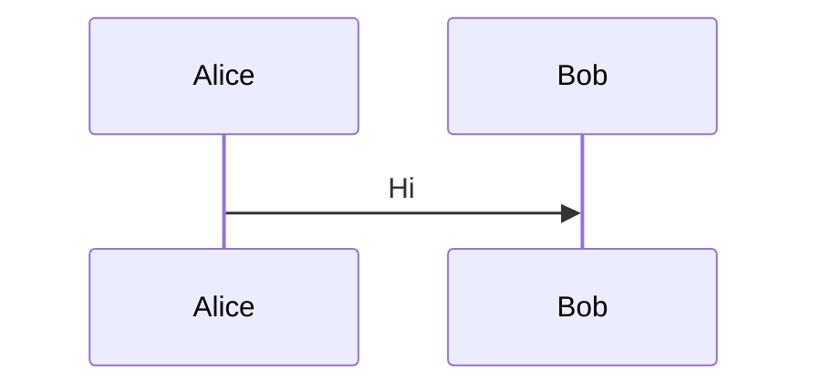

# Sample document

A valid diagram:



Not Mermaid, so it is ignored:

```js
const a = "A -> B";
```

A broken diagram inside a list:

1. Step one

   ```mermaid
   flowchart LR
     A --> B
     B --> C[Call foo(bar)]
   ```

> A broken diagram inside a block quote:
>
> ```mermaid
> pie title Pets
>   "Dogs" 3
> ```

An example that shows a fence, so it is not a diagram:

````markdown
```mermaid
flowchart TD
  A -> B
```
````

~~~{mermaid}
%%| fig-width: 6
flowchart TD
  A --> B
~~~

```mermaid
```
